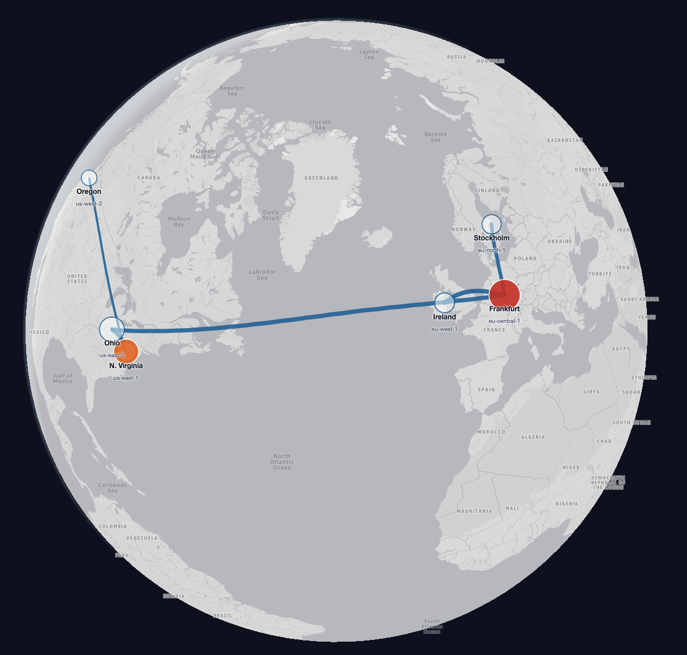

# bedrock-atlas

A map of who spends money on Amazon Bedrock, where requests were actually processed, and which savings are safe.

> You call AI from Frankfurt. Where was the request actually processed, who pays for it, and is there a better option?



## What the data shows

All numbers come from real Bedrock calls in a controlled test workload (see [Dataset](#dataset-and-limitations)).

| Finding | Evidence |
|---|---|
| Claude Haiku 4.5 called from **Frankfurt** via the `global.` profile was processed in **Ohio (us-east-2)** in 48 of 48 requests. | Invocation log `inferenceRegion` and CloudTrail agree on 46, the other 2 are seen in one source so far. |
| The same call via the `eu.` profile stayed in the EU (Ireland). `global.` is **9 % cheaper** ($1.00 vs $1.10 per 1M input tokens). | AWS Price List API. The saving and the data location are a trade-off, not a free win. |
| Nova Lite called from Frankfurt ran in **Stockholm**, but is billed at **Frankfurt prices — 30 % more** than the same call from N. Virginia. | Price follows the source region of the call, not the dot on the map. |
| Same number of requests, **14× cost** for team research. | Average output tokens grew from 34 to 693 (controlled "spike" scenario). |
| Nova Lite is 14–18× cheaper per token than Haiku 4.5, but scored **84/96** vs **96/96** on the benchmark. | Cheaper is only a recommendation after a measured comparison. |

## 60-second tour

1. Open the demo (link in the hackathon submission). The headline is computed from the data.
2. Click the **Frankfurt → Ohio** line, then any request: **Follow the request** shows identity (anonymized), team, source → processing region, evidence level, tokens, measured duration and estimated cost, each with its source.
3. Click **Frankfurt** or **Ohio**: what was billed there vs. what was processed there.
4. Press ▶ on the timeline and filter to team **research** to watch the spike.
5. Press **⚡ Try a live call**, pick a route (e.g. *Frankfurt · global. profile*) and watch your own request: tokens, duration and estimated cost appear at once, the processing region a few seconds later when the invocation log arrives.

## How it works

| Layer | Implementation |
|---|---|
| Dataset | Python + boto3, three IAM roles = three teams (`scripts/generate_dataset.py`) |
| Usage and identity | Bedrock model invocation logging → S3, per region |
| Processing region | Invocation log `inferenceRegion` + CloudTrail (management events), joined by request id |
| Normalization | `scripts/normalize.py`: dedup, join, identity mapping, evidence level, price |
| Pricing | AWS Price List API → `pricing/prices.json` (`scripts/discover_pricing.py`, `scripts/build_pricing.py`) |
| Public export | `scripts/export_public.py`: allow-listed fields, anonymized identities |
| Map | Amazon Location Service (Monochrome) + MapLibre, React + TypeScript (`web/`) |
| Hosting | S3 (private) + CloudFront with OAC |
| Live demo | CloudFront `/api/*` → API Gateway (HTTP API, throttled) → Lambda → Bedrock; invocation logs → CloudWatch Logs subscription → Lambda in each source region → DynamoDB |
| Infrastructure | Terraform modules in `infra/modules/*`, one root in `infra/envs/demo` |

### Processing region evidence

| Level | Meaning |
|---|---|
| `verified` | Invocation log and CloudTrail report the same `inferenceRegion`. |
| `observed` | Only one of the two sources has it so far. |
| `direct` | Call without an inference profile; processing region = source region (AWS on-demand behavior). |
| `unknown` | None of the above. Shown as "Unknown", never guessed. |

### Estimated inference cost

```
estimated_cost = input_tokens / 1M × input_price + output_tokens / 1M × output_price
```

Prices are on-demand text tokens without caching, keyed by **model, source region and inference mode** (`in_region`, `geo`, `global`), with source and effective date. Anything else is shown as **Unpriced**, never zero. This is an estimate, not a billing reconciliation.

### Identity

Team comes from a managed mapping of IAM roles (`config/identity_map.json`), never from client-sent `requestMetadata`. Shared roles are not turned into people. Only `team/session-N` pseudonyms are published.

## Dataset and limitations

- **Live calls** use a fixed prompt (no free text), five fixed routes, max 80 output tokens and a hard site-wide limit of 500 calls per UTC day. Their processing region comes from the invocation log only, so it is shown as `observed`. Live calls are not part of the published dataset.

- Controlled test workload created by the author with synthetic, non-sensitive texts (`dataset/inputs.json`). Not production customer traffic.
- One AWS account, source regions `eu-central-1` and `us-east-1`, Converse / ConverseStream API, models Claude Haiku 4.5 and Amazon Nova Lite.
- Collection date, record counts and coverage are in `web/public/data/meta.json` and in the app.
- Region points are approximate metro areas, lines are logical source → processing relationships, not network paths.
- The "spike" phase is a controlled scenario: team research asked for detailed analyses with the same number of requests.

## Reproduce in your account

Requirements: Terraform ≥ 1.10, AWS CLI, Python 3.11+ with boto3, Node 20+.

```bash
export AWS_PROFILE=<your-profile>

# 1. State bucket (once), then update the bucket name in infra/envs/demo/versions.tf
terraform -chdir=infra/bootstrap init && terraform -chdir=infra/bootstrap apply

# 2. Infrastructure
echo 'budget_email = "you@example.com"' > infra/envs/demo/terraform.tfvars
terraform -chdir=infra/envs/demo init && terraform -chdir=infra/envs/demo apply

# 3. Dataset (real Bedrock calls, hard cap $25 estimated)
python scripts/generate_dataset.py --phase baseline
python scripts/generate_dataset.py --phase spike

# 4. Pull logs, price, normalize, export (wait ~10 min for log delivery)
aws s3 sync s3://<invocation-log-bucket-eu-central-1> data/raw/invocation-logs/eu-central-1
aws s3 sync s3://<invocation-log-bucket-us-east-1> data/raw/invocation-logs/us-east-1
aws s3 sync s3://<cloudtrail-bucket> data/raw/cloudtrail
python scripts/discover_pricing.py && python scripts/build_pricing.py
python scripts/normalize.py && python scripts/export_public.py

# 5. Deploy the map
./scripts/deploy_web.sh
```

Raw logs and the client manifest stay in `data/` (gitignored). Invocation logs contain prompts and responses.

## Author

Roman Ceresnak
